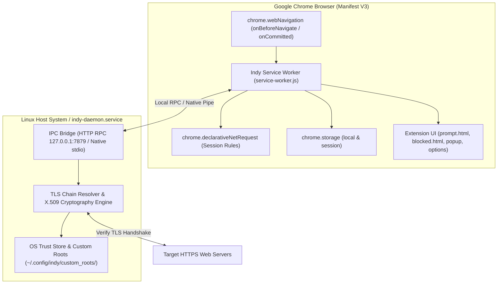
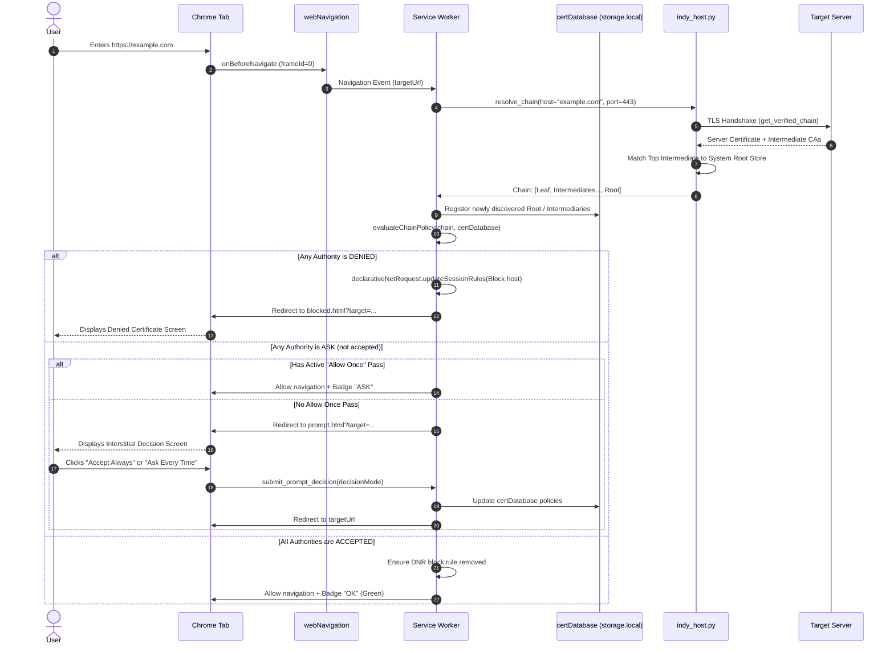

# Indy Architecture & Technical Specification

## 1. Executive Summary

Indy is a Chrome extension (Manifest V3) and companion Native Messaging / HTTP bridge that makes accepting root and intermediary Transport Layer Security (TLS) certificates visible and optional.

Modern web browsers blindly trust hundreds of pre-installed root Certificate Authorities (CAs) shipped by operating systems and root store programs. When an HTTPS connection is negotiated, the browser silently validates the certificate chain against these trust anchors without alerting the user or offering policy choices.

Indy inverts this paradigm:
1. It boots a local policy database directly from the host operating system's system root certificate store (e.g. `/etc/pki/ca-trust/extracted/pem/tls-ca-bundle.pem` on Fedora/RHEL or `/etc/ssl/certs/ca-certificates.crt` on Debian/Ubuntu).
2. It tracks both Root CAs and Intermediary CAs in a persistent hierarchy.
3. When an incoming certificate chain anchors to a Root CA (such as `indy` or commercial roots) or an Intermediary CA that is not explicitly marked as `accept`, Indy intercepts the navigation.
4. Indy presents an interstitial prompt displaying the full certificate chain hierarchy, allowing the user to select one of three policy actions:
   - Accept: Trust the certificate authority automatically on all future requests.
   - Ask: Prompt the user every time a connection chains to this authority (with one-time bypass for the current visit).
   - Deny: Refuse connections chaining to this authority and block domain subresources via Declarative Net Request (DNR) session rules.

---

## 2. Core Constraints & Technical Architecture

### 2.1 Manifest V3 Sandboxing & Host Bridge

Google Chrome Manifest V3 sandbox rules impose two key security boundaries:
- Extensions cannot read the host filesystem or execute local trust store utilities (`trust list`, `openssl`).
- Chrome's `chrome.webRequest` API does not expose X.509 certificate chains to extension JavaScript (unlike Firefox's `browser.webRequest.getSecurityInfo()`).

To solve these constraints cleanly across standard Chrome, Chromium, and Flatpak Chrome (`com.google.ChromeDev`), Indy implements a dual-transport host architecture:



### 2.2 Dual Transport Protocol (HTTP RPC & Native Messaging)

1. Local HTTP RPC (`http://127.0.0.1:7879/rpc`):
   - Preferred for Flatpak Chrome where containerized processes share the host network stack (`shared=network`) but cannot spawn arbitrary host binaries.
   - Maintained by a background systemd user service (`indy-daemon.service`).
2. Native Messaging Host (`com.etu.indy`):
   - Uses the standard 4-byte length-prefixed stdio protocol.
   - Automatically loaded when running inside native Chrome or Chromium packaging.

---

## 3. Data Models & Certificate Database Schema

Persistent records reside in `chrome.storage.local`. Ephemeral per-tab states and short-lived TLS caches reside in `chrome.storage.session`.

### 3.1 Certificate Record (`certDatabase[id]`)

```json
{
  "id": "sha256:749ed88a433149e1556befd993183055feee2c613a6ce38537088fd857ef2638",
  "fingerprint": "749ED88A433149E1556BEFD993183055FEEE2C613A6CE38537088FD857EF2638",
  "commonName": "indy",
  "organization": "Indy Root Certificate Authority",
  "country": "FI",
  "subject": "CN=indy,O=Indy Root Certificate Authority,C=FI",
  "issuerCommonName": "indy",
  "issuerOrganization": "Indy Root Certificate Authority",
  "issuer": "CN=indy,O=Indy Root Certificate Authority,C=FI",
  "role": "root",
  "isCA": true,
  "isSelfSigned": true,
  "subjectKeyId": "314404E76B98A71BEDC2F830B8CE21A07440E2F9",
  "authorityKeyId": "314404E76B98A71BEDC2F830B8CE21A07440E2F9",
  "serialNumber": "010000000000000001",
  "signatureAlgorithm": "sha256WithRSAEncryption",
  "notBefore": "2025-01-01T00:00:00+00:00",
  "notAfter": "2035-01-01T00:00:00+00:00",
  "source": "system",
  "policy": "ask",
  "firstSeenAt": "2026-10-22T00:00:00.000Z",
  "updatedAt": "2026-10-22T00:00:00.000Z"
}
```

### 3.2 Certificate Roles and Relations

- `role: "root"`: Trust anchor certificate. Typically self-signed (`subject == issuer`) or directly derived from the operating system's trust store.
- `role: "intermediate"`: Intermediate CA certificate issued by a Root CA or higher-level Intermediate CA. Contains a `parentId` field referencing its issuer's SHA-256 fingerprint ID.
- `role: "leaf"`: End-entity TLS certificate issued to the web host. Not stored permanently in `certDatabase`, but inspected dynamically during navigations.

### 3.3 Private & Custom Root Certificate Ingestion

In addition to system trust stores, Indy supports provisioning private, enterprise internal, and development root CAs:
1. Upload & Parsing:
   Users upload or paste PEM-encoded X.509 certificates (`.pem`, `.crt`, `.cer`) via the Options UI modal. The service worker delegates parsing to `indy_host.py` via `parse_certificate`, which uses the Python `cryptography.x509` engine to extract Subject, Issuer, Serial Number, Basic Constraints (`isCA`), and SHA-256 fingerprint without persisting anything prematurely.
2. Host Persistence (`~/.config/indy/custom_roots/`):
   Upon user confirmation (`upload_root_certificate`), the host daemon writes the PEM data to `$HOME/.config/indy/custom_roots/<FINGERPRINT>.pem` and registers it directly into `indy_host.py`'s live authority index (`_roots_by_id`, `_roots_by_ski`, `_roots_by_subject`).
3. Browser State Synchronization:
   The background service worker registers the new authority in `chrome.storage.local.certDatabase` with `source: "custom"` and the user's initial policy choice (`ask`, `accept`, `deny`). Custom roots are dynamically displayed with a distinct `Private CA` badge in the database manager and can be deleted on-demand with one click (`delete_custom_root`), cleanly removing the host PEM file and browser policy record.

---

## 4. Policy Evaluation & Interception Lifecycle

When the user navigates to an HTTPS website, Indy evaluates the chain in real time before page content loads:



### 4.1 Evaluation Rules & Precedence

1. Rule 1 - Denial Precedence:
   If any certificate in the authority chain (Root CA or any Intermediate CA) is set to `deny`, the entire connection is rejected immediately.
2. Rule 2 - Intermediary Enforcement:
   When `enforceIntermediates` is enabled (default), both Root and Intermediate CAs must have `policy === "accept"` for automated pass-through. If an accepted Root CA has an intermediate with `policy === "ask"`, the user is prompted specifically for that intermediate.
3. Rule 3 - Acceptance Criteria:
   Only when all authority certificates in the chain are marked as `accept` does Indy permit the connection without user friction.

---

## 5. Security & Isolation Considerations

- Content Security Policy (CSP): Extension pages enforce strict MV3 CSP. No inline scripts, no `eval()`, and no remote code execution. All dynamic DOM nodes are created safely via `document.createElement()` and `textContent`.
- Network Isolation via DNR: When a certificate is denied, Indy doesn't simply redirect the main HTML document; it injects a Declarative Net Request session rule blocking subresources (scripts, XMLHttpRequests, stylesheets, fonts, websockets) to prevent covert data leakage.
- Deterministic Identity: The extension manifest specifies a deterministic 2048-bit RSA public key, locking the extension ID across all installations and test environments to `hmfkankhnneijoaagpgpdcccmoadjaep`.
