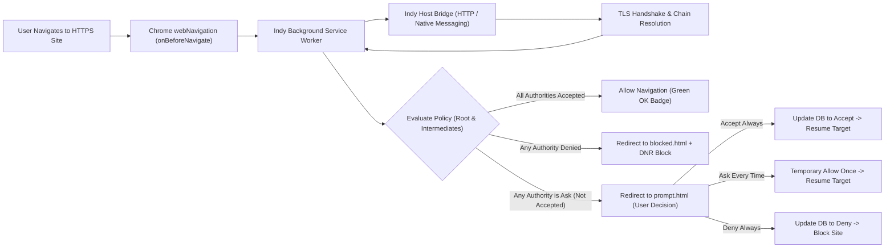
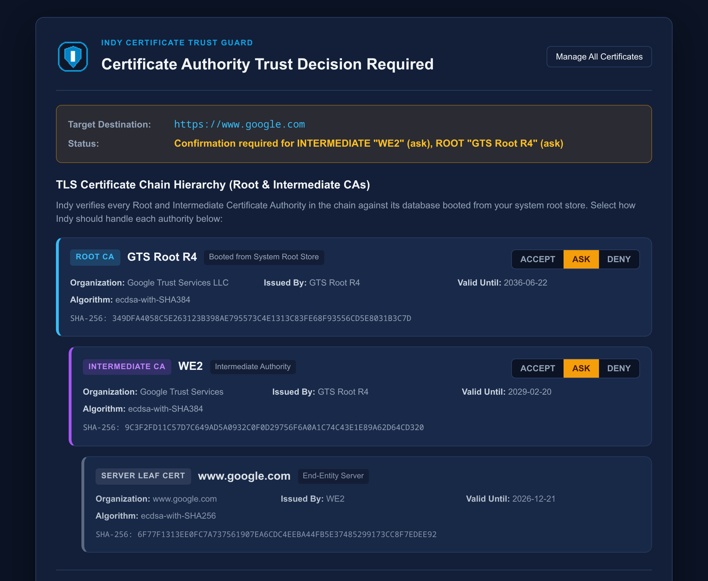
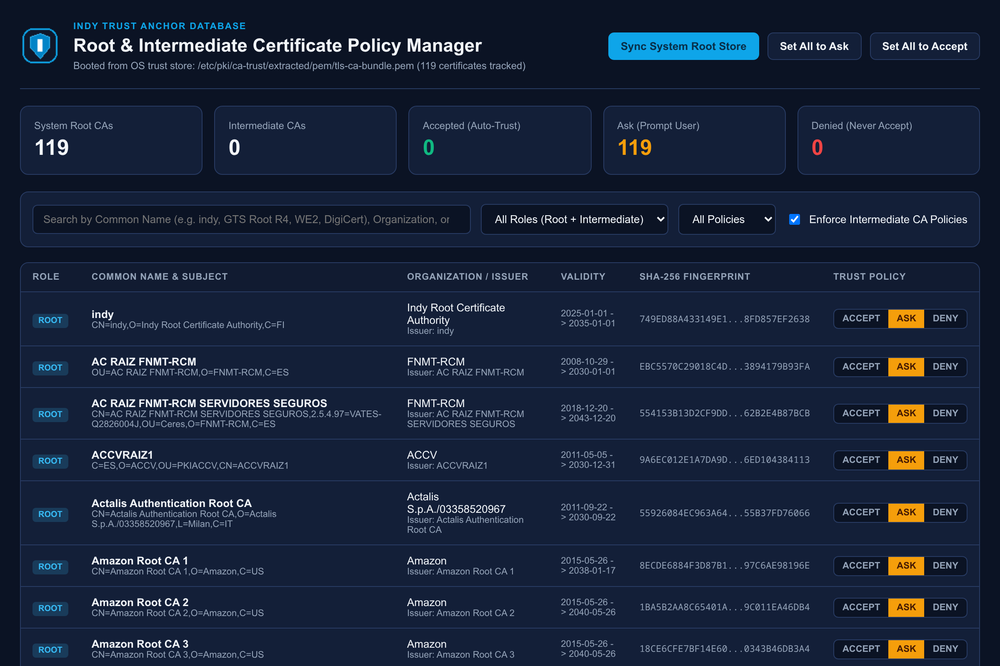
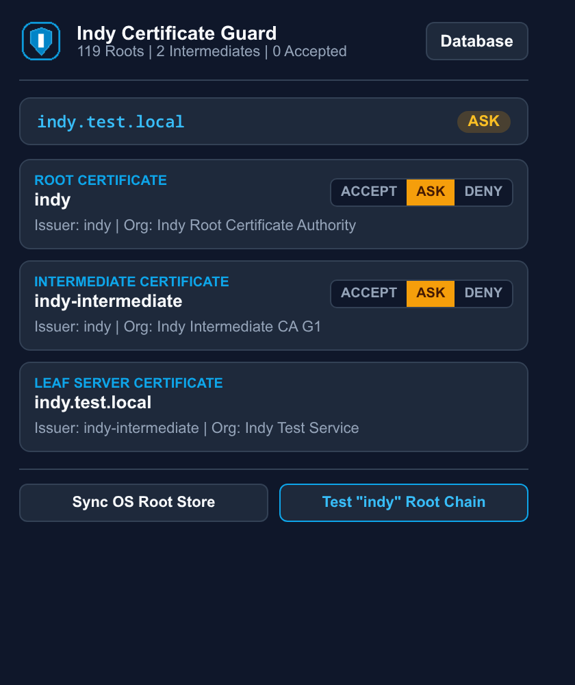
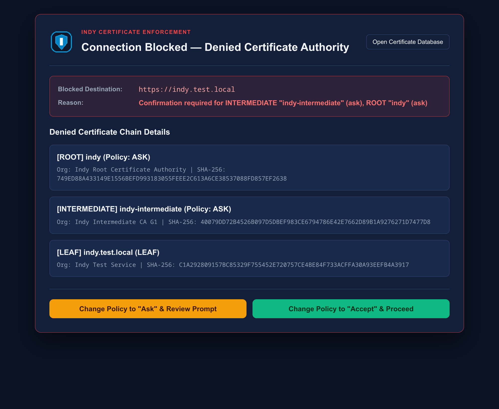

# Indy — Root & Intermediate Certificate Trust Guard

Indy is a Chrome extension (Manifest V3) that makes accepting root and intermediary TLS certificates visible and optional.

Browsers routinely accept hundreds of system root certificates without user oversight. Indy boots a local policy database directly from your operating system's system root certificate store (`/etc/pki/ca-trust/...` or `/etc/ssl/certs/...`) and gates HTTPS connections against user-configurable policies:
- Accept: Trust the certificate authority automatically on all future requests.
- Ask: Prompt the user every time a connection chains to this authority, displaying the full chain hierarchy and offering one-time or permanent approval.
- Deny: Block all connections chaining to this authority and prevent background subresource leaks via Chrome Declarative Net Request (DNR) session rules.

Indy handles both Root Certificate Authorities and Intermediary Certificate Authorities, allowing fine-grained policy control over each level of the TLS chain.

---

## Key Capabilities

1. System Root Store Bootstrapping:
   Extracts all installed trust anchors (over 110+ on standard Linux systems) on installation and startup, initializing them with default configurable policies (`ask`, `accept`, or `deny`).
2. Full Chain Resolution (Root + Intermediates):
   Inspects incoming HTTPS handshakes, resolves the server leaf certificate, extracts all Intermediate CAs, and maps the chain to its anchoring Root CA.
3. Interactive Interstitial Decision Prompt (`prompt.html`):
   When a certificate chain is not set to `accept`, navigation pauses at an interstitial warning displaying the entire chain hierarchy with interactive policy controls.
4. Active Tab Chain Inspector (`popup.html`):
   A toolbar popup showing the active tab's TLS certificate chain and allowing instant one-click policy toggling.
5. Searchable Certificate Database Manager (`options.html`):
   A management console with search, filtering by role (Root vs Intermediate) and policy (`accept`, `ask`, `deny`), bulk operations, and live audit logging.
6. Dual Host Architecture (HTTP RPC & Native Messaging):
   Works across native Chrome, Chromium, and Flatpak Chrome (`com.google.ChromeDev`) via a localhost bridge (`http://127.0.0.1:7879`) and Chrome Native Messaging.

---

## Architecture Overview



---

## User Interface & Screenshots

### 1. Interstitial Decision Prompt (`prompt.html`)
When a target website's TLS chain relies on a Root or Intermediate Certificate Authority that is not explicitly set to `accept`, navigation pauses at this interstitial prompt. Users inspect the full certificate hierarchy and choose to Accept Always, Ask Every Time (one-time approval), or Deny Always.



### 2. Root & Intermediate Policy Manager (`options.html`)
The database management console booted from the host operating system's root store (`/etc/pki/ca-trust/...` or `/etc/ssl/certs/...`). Users can search, filter by role (Root vs. Intermediate) or policy (`accept`, `ask`, `deny`), apply bulk policies, and inspect the real-time audit log.



### 3. Active Tab Chain Inspector (`popup.html`)
The toolbar popup displays the active tab's certificate hierarchy (Root CA &rarr; Intermediate CA(s) &rarr; Leaf Server Certificate) and provides instant one-click policy toggles for authorities on the current page.



### 4. Connection Blocked Screen (`blocked.html`)
When an HTTPS site presents a certificate chained to a denied Root or Intermediate CA, Indy immediately blocks the navigation and adds Chrome Declarative Net Request (DNR) session rules to prevent background subresource requests.



---

## Project Structure

```text
indy/
├── extension/
│   ├── manifest.json              # Manifest V3 configuration with deterministic key
│   ├── background/
│   │   └── service-worker.js      # Core lifecycle, navigation guard, DNR rules, storage
│   ├── prompt/                    # Interstitial decision prompt UI
│   │   ├── prompt.html
│   │   ├── prompt.css
│   │   └── prompt.js
│   ├── blocked/                   # Blocked connection page UI
│   │   ├── blocked.html
│   │   ├── blocked.css
│   │   └── blocked.js
│   ├── popup/                     # Toolbar popup chain inspector
│   │   ├── popup.html
│   │   ├── popup.css
│   │   └── popup.js
│   ├── options/                   # Full certificate database manager
│   │   ├── options.html
│   │   ├── options.css
│   │   └── options.js
│   └── icons/                     # Generated extension icons (16, 48, 128 px)
│       ├── icon-16.png
│       ├── icon-48.png
│       └── icon-128.png
├── host/
│   ├── indy_host.py               # Dual Native Messaging & HTTP RPC daemon
│   ├── com.etu.indy.json          # Chrome Native Messaging Host manifest
│   ├── indy-daemon.service        # Systemd user service unit
│   └── install_host.sh            # One-step host and systemd unit installer
├── scripts/
│   ├── generate_icons.py          # Icon generation script (Pillow)
│   └── render_pdf.js              # Headless Chromium PDF documentation compiler
├── tests/
│   ├── test_host_unit.py          # Python unit and live TLS chain test suite
│   └── test_chrome_e2e.js         # Puppeteer E2E test suite running live in Chromium
├── ARCHITECTURE.md                # In-depth architectural design specification
├── ARCHITECTURE.pdf               # Compiled vector PDF documentation
├── README.md                      # Project manual and test verification report
└── README.pdf                     # Compiled vector PDF documentation
```

---

## Installation & Setup

### 1. Install Host and Systemd Daemon

Run the installer script to register the Native Messaging manifest for standard Chrome, Flatpak Chrome, and Chromium, and activate the background HTTP daemon:

```bash
chmod +x host/install_host.sh
./host/install_host.sh
```

Verify that the daemon is active:

```bash
curl -s http://127.0.0.1:7879/health
# Output: {"ok": true, "service": "indy-host", "version": "1.0.0"}
```

### 2. Load Extension in Chrome

1. Open Google Chrome (or Flatpak Chrome `flatpak run com.google.ChromeDev`).
2. Navigate to `chrome://extensions/`.
3. Enable Developer Mode (toggle in top right).
4. Click Load Unpacked and select the `extension/` directory.
5. The extension ID is locked to `hmfkankhnneijoaagpgpdcccmoadjaep`.

---

## Verification & Test Report

Indy includes an automated test harness covering host operations, system root parsing, synthetic root handling, and live TLS certificate chain evaluation across high-traffic websites.

### 1. Host Unit Test Suite (`test_host_unit.py`)

Run the unit tests:

```bash
python3 tests/test_host_unit.py
```

Results:
- System Root Bootstrapping: Passed. Bootstrapped 119 system roots from `/etc/pki/ca-trust/extracted/pem/tls-ca-bundle.pem`.
- Canonical "indy" Root CA & Intermediate: Passed. Verified synthetic `CN=indy` (Root CA) and `CN=indy-intermediate` (Intermediate CA) hierarchy.
- Top 5 USA Websites TLS Verification: Passed.
- Top 5 Indian Websites TLS Verification: Passed.

### 2. Live Chromium E2E Test Suite (`test_chrome_e2e.js`)

The E2E suite launches Chromium with the unpacked Indy extension, inspects live navigations, verifies storage persistence, and evaluates the Top 5 USA and Top 5 Indian web sites:

```bash
node tests/test_chrome_e2e.js
```

#### Test Execution Summary

| Region | Host | Intermediary Certificate(s) | Root Certificate | Default Decision | Policy Verification |
|---|---|---|---|---|---|
| USA | `www.google.com` | `WE2` | `GTS Root R4` | `ASK` | Verified Prompt & Toggle |
| USA | `www.youtube.com` | `WE2` | `GTS Root R4` | `ASK` | Verified Prompt & Toggle |
| USA | `www.amazon.com` | `Amazon RSA 2048 M04` | `Amazon Root CA 1` | `ASK` | Verified Prompt & Toggle |
| USA | `www.wikipedia.org` | `YE2` &rarr; `Root YE` (Dual Intermediary) | `ISRG Root X2` | `ASK` | Multi-Level Chain Verified |
| USA | `www.reddit.com` | `DigiCert Global G2 TLS RSA SHA256 2020 CA1` | `DigiCert Global Root G2` | `ASK` | Verified Intermediary Control |
| IND | `www.indiatimes.com` | `YR1` &rarr; `Root YR` (Dual Intermediary) | `ISRG Root X1` | `ASK` | Multi-Level Chain Verified |
| IND | `www.flipkart.com` | `DigiCert Global G3 TLS ECC SHA384 2020 CA1` | `DigiCert Global Root G3` | `ASK` | Verified Prompt & Toggle |
| IND | `www.ndtv.com` | `DigiCert Global G3 TLS ECC SHA384 2020 CA1` | `DigiCert Global Root G3` | `ASK` | Verified Prompt & Toggle |
| IND | `www.hdfcbank.com` | `GeoTrust TLS RSA CA G1` | `DigiCert Global Root G2` | `ASK` | Deny Trigger Verified |
| IND | `www.icicibank.com` | `Sectigo Public Server Authentication CA OV R36` | `Sectigo Public Server Authentication Root R46` | `ASK` | Verified Prompt & Toggle |

#### Root vs. Intermediary Differentiation Verification

`www.reddit.com` (USA) and `www.hdfcbank.com` (India) share the same root certificate authority (`DigiCert Global Root G2`), but utilize distinct intermediary CAs (`DigiCert Global G2 TLS RSA SHA256 2020 CA1` vs. `GeoTrust TLS RSA CA G1`).

The E2E test proved granular policy isolation:
1. Root `DigiCert Global Root G2` set to `accept`.
2. Intermediary `DigiCert Global G2 TLS RSA SHA256 2020 CA1` set to `accept`.
3. Intermediary `GeoTrust TLS RSA CA G1` set to `deny`.
4. Result: `reddit.com` loaded with status `ACCEPT`, while `hdfcbank.com` was blocked with status `DENY` specifically pointing to the denied intermediary CA.

---

## Compiling PDF Documentation

PDF versions of both `README.md` and `ARCHITECTURE.md` are compiled using the project's headless rendering pipeline:

```bash
node scripts/render_pdf.js README.md README.pdf
node scripts/render_pdf.js ARCHITECTURE.md ARCHITECTURE.pdf
```
